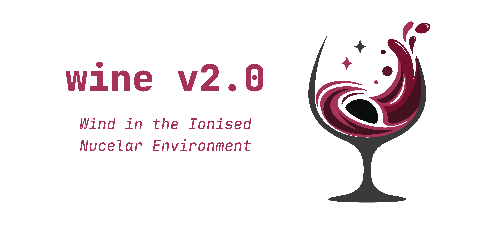
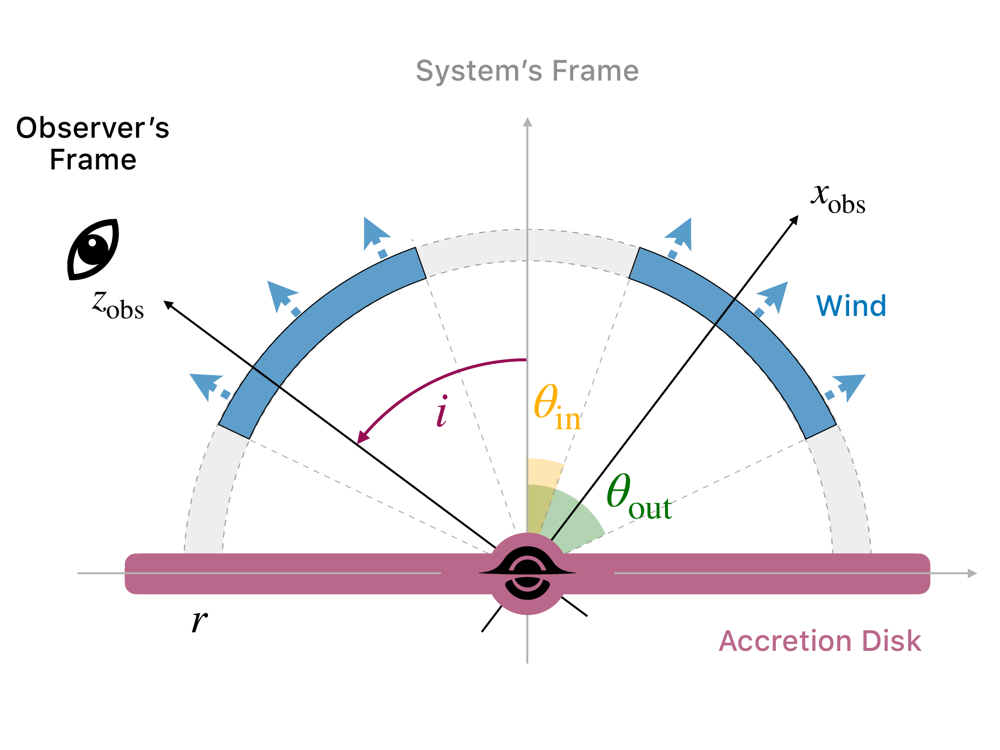

# WINE — Wind in the Ionised Nuclear Environment

WINE is a spectroscopic model for emission and absorption from outflows around compact astrophysical sources, particularly accreting black holes. It combines fast analytical outflow profiles with accurate special relativistic effects and viewing geometry, treating both spectral components consistently. It is designed for outflows up to mildly relativistic speeds, including ultra-fast outflows in active galactic nuclei (AGN), and can be used to explore winds in X-ray binaries and gamma-ray bursts when its assumptions apply.

## WINE `v2.0`

WINE `v2.0` separates the wind model from the calculation of its rest-frame spectrum. It acts as a post-processing layer: users can supply their own spectra or generate them with photoionisation codes such as CLOUDY or XSTAR, then apply WINE's relativistic emission and absorption models. This makes it practical to explore individual wind shells and their geometry without rerunning a photoionisation calculation at every model evaluation. The present shell-based approach is aimed primarily at approximately Compton-thin winds (roughly $N_\mathrm{H} \lesssim 10^{24}\,\mathrm{cm}^{-2}$); its validity still depends on the supplied spectra and the physical assumptions of a particular application.

This direction is motivated in part by the detail now accessible in high-resolution X-ray spectra from XRISM.

The [`wine v1` implementation](https://baltig.infn.it/ionisation/wine) remains available as a complementary tool. It models a connected, initially homogeneous outflow through successive XSTAR calculations, retaining the coupled wind treatment useful for that approach.

## What is in this repository?

| Path                         | Contents                                                                                        |
| ---------------------------- | ----------------------------------------------------------------------------------------------- |
| [`src/wine/`](src/wine/)     | Python wind kernels, slab models, standalone spectral-grid interpolation, and OGIP table reader |
| [`xspec/`](xspec/)           | Local XSPEC models for emission profiles and relativistic spectral shifts                       |
| [`procedures/`](procedures/) | Tested profile-search implementation being adapted to the new geometry API                      |
| [`tests/`](tests/)           | Python tests for grids, table reading, and model evaluation                                     |
| [`docs/`](docs/)             | API, spectral input, XSPEC, and development documentation                                       |

WINE reads precomputed spectra; it does not run CLOUDY or XSTAR. No production spectral grid is bundled with this repository.

The Python models can be used in any Python workflow, including custom fitting or simulation routines. XSPEC is one supported interface; the example below shows how to use the models there.

## Python

For Python 3.10 or newer, install in an environment of your choice:

```bash
git clone https://github.com/pier-astro/wine.git
cd wine
python -m pip install -e '.[fits]'
```

The `fits` extra provides Astropy for OGIP FITS tables. NumPy and SciPy are the core Python dependencies. Import the model with `import wine`; see the [Python guide](docs/python.md) for array and table inputs, units, and examples.

`wine.SpectralGrid` can also interpolate spectra directly in Python, without evaluating a wind model. It accepts multidimensional NumPy arrays or OGIP tables or another compatible tool. Spectral values default to logarithmic interpolation; choose `interpolation="linear"` when needed.

## XSPEC quick start

Initialize HEASoft/XSPEC and build the local models:

```bash
cd xspec
./build.sh
```

In XSPEC, load WINE, your data, and a model with separate intrinsic absorption
of the central continuum and wind emission:

```tcl
lmod wine /absolute/path/to/wine/xspec
@data.xcm
model TBabs*((wind*mtable{cloudy.mmod})*powerlaw+windemlos*atable{cloudy.amod})
```

The table filenames are examples; supply your own spectra and set the table
parameters. This development API replaces the previous angular coordinates:
**convert old XCM sessions before loading them**. See the
[model reference](xspec/README.md#emission-geometry-development-api).

| Model | Parameters |
| --- | --- |
| `windem` | `vout, Cf, hole, incl` |
| `windemlos` | `vout, Cf, skew, incl` |
| `windemoff` | `vout, Cf, hole, view, region` |

`Cf` is the wind's covering fraction of one hemisphere. Generic `hole` places
the shell independently of `incl`. LoS `skew` instead places a shell that
includes the fitted inclination. The off model uses `view` within a selected
polar/equatorial sector; keep its `region` switch frozen and compare sectors
in separate fits. These coordinate conversions share the same spectral kernel.

For the expression above, link the absorption and emission velocities and
identify the direct physical parameters:

```tcl
show parameters
set vabs [lindex [tcloutr compinfo 2] 1]
set vem [lindex [tcloutr compinfo 5] 1]
newpar $vem = p$vabs
set cover [expr {$vem + 1}]
set incl [expr {$vem + 3}]
energies extend low 0.1 500 log
energies extend high 30 500 log
fit
error 1. $cover $incl
```

Choose the energy margins and sampling for your velocities and supplied
spectra, within their table support. Here `1.` is a change in statistic, not a
sigma value. With no chains loaded, XSPEC profiles the two direct parameters
separately, refitting other free parameters. The existing local covariance
approximation and profile-convergence limitations still apply.



Physical `tin`/`tout` and off-model inclination can be reconstructed with
Python's `Geometry` constructors, including joint posterior arrays. Native
errors on `hole`, `skew`, or `view` are not errors on those derived angles.
The consolidated `windgeom`, `winderror`, and `windsteppar` procedures are
available with documented constraint and covariance limits in the
[procedure guide](procedures/README.md); older `wineincl*` commands do not support
the new coordinates. The model/geometry implementation should be validated for your
analysis before replacing scientific fit results.

The [XSPEC guide](docs/xspec.md) also covers the models, tests, and `./clean.sh` rebuild workflow. Generated binaries and local build files are excluded from Git.

## Documentation

- [Python models and spectral inputs](docs/python.md)
- [XSPEC models and local build](docs/xspec.md)
- [Repository structure and development](docs/development.md)

The physical model and its domain of validity will be documented in greater depth alongside the associated publication.
<!-- The earlier WINE model is described in [Luminari et al. (2024)](https://arxiv.org/abs/2410.13933). -->

If WINE supports a publication, please acknowledge the project. Citation guidance will be added with the accompanying paper; questions and feedback are welcome through the [project repository](https://github.com/pier-astro/wine).

WINE `v2.0` is distributed under [GPL-3.0-or-later](LICENSE).
